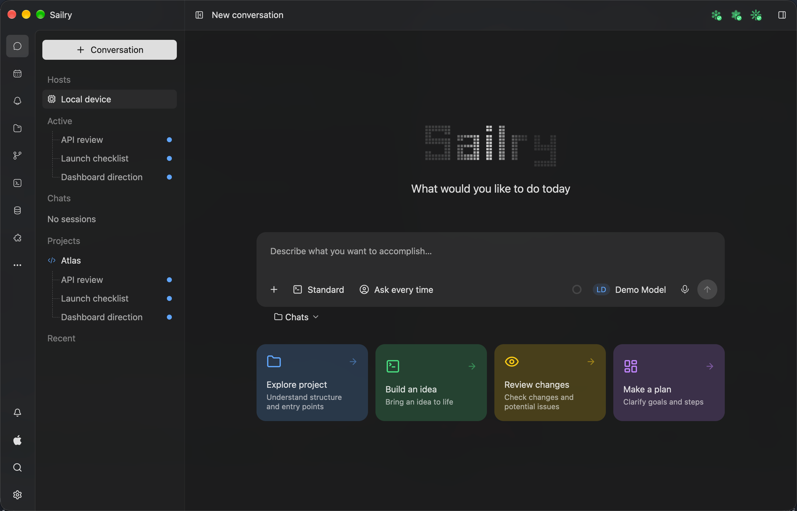

# CheapRouter Desktop

基于 [Sailry](https://github.com/sailry/sailry-harness) 开发的 CheapRouter 原生桌面客户端，使用 Go 与 [MyGo](https://github.com/egoist/mygo) 原生 GPU UI 工具包构建，将低价多模型网关、内置编码 Agent 工作台、创作工作台与插件生态集成于单一桌面应用。

> 本仓库派生自 [sailry/sailry-harness](https://github.com/sailry/sailry-harness)（Apache-2.0），详见 [NOTICE](NOTICE) 与 [LICENSE](LICENSE)。

## 应用截图

<!-- 截图占位：替换为最新客户端界面截图 -->
| 主工作台 / 会话视图 | 创作工作台 / 账号与模型分组 |
| :---: | :---: |
|  | _[待补充：创作工作台 / 账号分组与模型选择截图]_ |

## 核心特性

- **原生轻量界面**：纯 Go + MyGo 原生绘制，无 Electron 壳，长会话渲染流畅；无 GPU 环境下自动降级到 CPU 渲染。
- **内置 Agent 工作台**：原生执行循环、多文件编辑、Git / Worktree 管理、内置终端、代码审查与插件系统，支持通过 iroh P2P 加密链路连接远程 Host。
- **CheapRouter 账号与网关联动（可选）**：支持主站与 CDN 线路切换、PKCE 本地回跳登录、多平台计费分组与在线率展示、余额与套餐同步；未登录时本地项目、会话与自定义模型服务商仍可正常使用。
- **创作工作台（Image Studio）**：统一文生图与图生图入口，支持网关生图模型与自定义画图接口配置、任务调度与本地保存。
- **旧版数据无损迁移**：首次启动只读检测旧版数据目录，先完整备份再按稳定 ID 导入项目、会话与历史记录。

## 本地开发

### 环境要求

- **Go**：`go1.27.3`（`GOTOOLCHAIN=go1.27.3`，默认禁用 cgo：`CGO_ENABLED=0`）
- **Native 工具链**：首次编译本地原生动态库（`native/iroh`、`native/turso`、`native/capture`）需安装对应构建工具（`native/iroh` 与 `native/turso` 通过 `rust-toolchain.toml` 固定工具链版本 `1.98.0`；`native/capture` 需要 C 编译器）
- **可选工具**：`just`（快捷任务）、`jq`（打包脚本）、`node >= 22.13`（插件测试）

### 一键启动开发客户端

```sh
./dev-desktop.sh [dev|release|<profile>] [额外启动参数]
```

`dev-desktop.sh` 会自动检测平台与架构，按需构建并复用 `.runtime/native/<platform>-<arch>/` 下的原生动态库，随后运行 `go run ./cmd/sailry-desktop`：

- `dev`（默认）：数据目录 `$HOME/.sailry-dev`（隔离正式版数据）
- `release`：数据目录 `$HOME/.sailry`
- `<profile>`：数据目录 `.runtime/profiles/<profile>`

仅查看隔离的 UI 预览（不打开 profile、不启动 Node）：

```sh
unset GOROOT && export GOTOOLCHAIN=go1.27.3 CGO_ENABLED=0
go run ./cmd/sailry-desktop --preview
```

### 常用环境变量

| 环境变量 | 说明 |
| --- | --- |
| `GOTOOLCHAIN` | 固定为 `go1.27.3`（运行 Go 命令前建议先 `unset GOROOT`） |
| `CGO_ENABLED` | 固定为 `0`（原生动态库通过 `purego` / `dlopen` 按需加载） |
| `SAILRY_IROH_LIB` | 指定 `libsailry_iroh.{dylib,so}` / `sailry_iroh.dll` 路径 |
| `SAILRY_TURSO_LIB` | 指定 `libturso_sync_sdk_kit.{dylib,so}` / `turso_sync_sdk_kit.dll` 路径 |
| `SAILRY_HELPERS_DIR` | 指定辅助工具目录（如 `.runtime/native/<os>-<arch>/helpers`） |
| `SAILRY_ARCH` | 交叉编译或打包时覆盖目标架构（`arm64` / `amd64`） |
| `SAILRY_TELEMETRY` | 设为 `off`（或 `DO_NOT_TRACK=1`）可关闭匿名诊断遥测 |
| `MYGO_UPDATE_FEED_URL` | 打包期注入 MyGo 更新清单基址（默认 `https://s3.cheaprouter.cc/cheaprouter-releases/mygo`） |
| `MYGO_UPDATE_PUBLIC_KEY` | 打包期注入 MyGo 第二跳 Ed25519 公钥（base64） |

### Native 原生库

Go 主程序保持 `CGO_ENABLED=0`，运行期通过 `dlopen` 加载三个原生库，产物统一缓存于 `.runtime/native/<os>-<arch>/`：

```sh
sh native/iroh/build.sh      # P2P 加密传输与中继库（libsailry_iroh）
sh native/turso/build.sh     # 本地持久化与同步库（libturso_sync_sdk_kit）
sh native/capture/build.sh   # 平台音频采集库（libsailry_capture）
```

> 仅修改 Go 代码时无需重新编译 native 库；也可以通过 `go run ./native/fetch` 拉取锁定版本的预编译产物。

## 构建与打包

### 编译全部 Go 包

```sh
unset GOROOT && export GOTOOLCHAIN=go1.27.3 CGO_ENABLED=0
go build ./...
```

### 发行版打包

在仓库根目录执行对应平台的打包脚本（支持 `--dry-run` 在 Linux 上预检配置与产物路径）：

```sh
# macOS（产出 .app、.dmg、第一跳更新 .zip、第二跳 MyGo .tar.gz）
./cmd/sailry-desktop/macos/package.sh -arch arm64 --require-update-key
./cmd/sailry-desktop/macos/package.sh -arch amd64 --require-update-key

# Windows（产出 Inno Setup -Setup.exe、便携 .zip、第二跳 MyGo .tar.gz）
./cmd/sailry-desktop/windows/package.sh -arch amd64 --require-update-key
./cmd/sailry-desktop/windows/package.sh -arch arm64 --require-update-key
```

CI 发布流水线定义在 [`.github/workflows/release.yml`](.github/workflows/release.yml) 与 [`.github/workflows/sync-release.yml`](.github/workflows/sync-release.yml)，完整发布与回滚手册见 [docs/RELEASING.zh.md](docs/RELEASING.zh.md)。

## 热更新（两跳模型）

发布链使用同一个对象存储桶（`cheaprouter-releases`）与两把独立的 Ed25519 密钥，兼顾旧版客户端原地升级与 MyGo 客户端原生热更新：

1. **第一跳（旧版 v0.3.x → MyGo v0.4.0+）**：
   - macOS：保持 Bundle ID `sh.waku` 与递增数值 `CFBundleVersion`（`major*1_000_000 + minor*1_000 + patch`），由 `scripts/appcast.ts` 签发桶根 `appcast.xml`，指向 `CheapRouter-<v>.zip`。
   - Windows：保持既有 Inno Setup `AppId` 并在安装前清理旧版可执行文件，由 `scripts/appcast-windows.ts` 签发桶根 `appcast-windows-{x86_64,aarch64}.xml`，指向静默安装器 `CheapRouter-<v>-<arch>-Setup.exe`。
2. **第二跳（MyGo v0.4.0+ → 后续 MyGo 版本）**：
   - 打包后由 `cmd/mygo-manifest pack/sign/verify` 对四端 `.tar.gz` 的 SHA-256 摘要做 Ed25519 签名，产出 `mygo/update-{darwin-arm64,darwin-amd64,windows-amd64,windows-arm64}.json`。
   - 客户端通过 `internal/update` 与 MyGo 内置更新器拉取清单、验签并执行原子替换；上传顺序严格遵循「先传不可变归档，再更新短缓存清单」。

## 架构简述

核心代码按五层单向依赖组织，详见 [ARCHITECTURE.md](ARCHITECTURE.md)：

```text
Desktop UI (internal/desktop, MyGo)
        │  视图投影 / 动作分发 (internal/desktop/live)
        ▼
Client (internal/client)
        │  命令发送 / 事件归约 / 断线恢复
        ▼
Link (internal/link, iroh P2P / 本地传输)
        │  对等认证 / 帧传输 / 回执
        ▼
Node (internal/node, Agent 引擎 / Turso 存储 / 工具与插件运行时)
        ▲
Protocol (internal/protocol, 共享命令 / 事件 / 快照 / 线协议定义)
```

| 模块 | 职责 |
| --- | --- |
| `internal/protocol` | 命令、事件、ID、快照、错误码、能力声明及 `wire` 编解码契约 |
| `internal/link` | 节点身份、配对、本地传输与基于 `iroh` 的端到端加密通信、回执与重连 |
| `internal/client` | 类型化命令调用、有序事件投影、去重以及请求与快照恢复 |
| `internal/node` | Agent 执行引擎、模型适配、工具、Git/文件/终端资源服务、Turso 持久化与插件宿主 |
| `internal/desktop` | MyGo 桌面壳、共享控件库（`kit`）、主题、多语言（`i18n`）、侧栏/会话/设置/创作工作台视图与 `live` 绑定层 |
| `internal/cheapauth` | CheapRouter 账号认证、PKCE 回调、网关线路与分组/余额同步 |
| `internal/imagestudio` | 创作工作台后端客户端、任务存储与画图接口配置 |
| `internal/update` | MyGo 第二跳热更新配置、检查与安装接入 |
| `internal/migrate` | 旧版客户端项目、会话与历史的只读备份与无损迁移 |

## 目录结构

```text
.
├── go.mod / go.sum           # Go 模块定义（github.com/ai-poet/agent-client）
├── bundled.go                # 嵌入内置插件与主题资源
├── dev-desktop.sh            # 跨平台本地开发启动脚本
├── justfile                  # 常用开发与检查任务配方
├── cmd/
│   ├── sailry-desktop/       # 桌面端主入口、mygo.json 及 macOS/Windows 打包脚本
│   ├── sailry-host/          # 无头 Host 后台服务入口
│   ├── mygo-manifest/        # MyGo 第二跳更新归档打包与 Ed25519 清单签名/校验工具
│   ├── gen-win-icon/         # Windows 多尺寸 .ico 生成工具
│   └── update-model-catalog/ # 模型目录快照更新工具
├── internal/                 # 核心业务与桌面端实现（protocol / link / client / node / desktop 等）
├── native/                   # 原生动态库源码、构建脚本与锁定清单（iroh / turso / capture / fetch / windows）
├── assets/                   # 品牌图标、预置目录与文档资源
├── locales/                  # 多语言源文件（经 go generate 生成内嵌词典）
├── plugins/                  # 内置官方插件快照
├── themes/                   # 内置主题快照
├── schemas/                  # 插件与清单 JSON Schema
├── sdk/                      # 插件 TypeScript 声明与开发文档（sdk/plugins.md）
├── scripts/                  # 发布辅助脚本（第一跳 appcast 签发、CHANGELOG 提取、macOS 安装脚本）
├── docs/                     # 发布手册（RELEASING.zh.md）、能力裁剪记录与测试预算说明
├── .github/workflows/        # CI 测试、MyGo 两跳发布与 R2 同步流水线
├── LICENSE                   # Apache-2.0 许可证
├── NOTICE                    # Sailry 上游与第三方归属声明
└── third_party_licenses/     # 第三方依赖与组件完整许可文本
```

## 开源归属与许可证

- 本项目基于 [Sailry](https://github.com/sailry/sailry-harness) 派生，遵循 **Apache License 2.0** 协议，完整文本见 [LICENSE](LICENSE)。
- Sailry 上游及第三方组件（MyGo、CrychicUI、Ghostty、Codex/Goose/Rig/ADK 衍生源码、字体、图标与原生运行时等）的著作权与来源声明完整保留于 [NOTICE](NOTICE) 与 [third_party_licenses/](third_party_licenses/)。
- Apache-2.0 许可不授予 Sailry 商标与标识使用权，详见 [TRADEMARKS.md](TRADEMARKS.md)。
