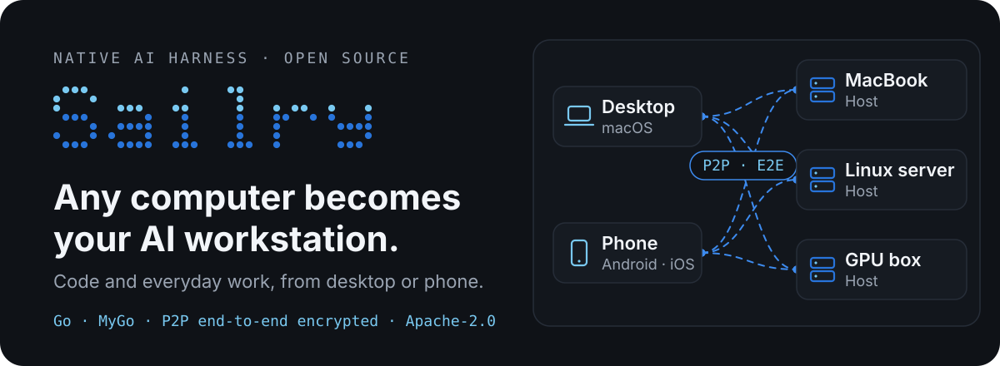
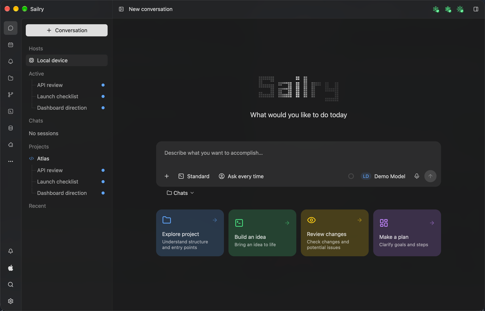
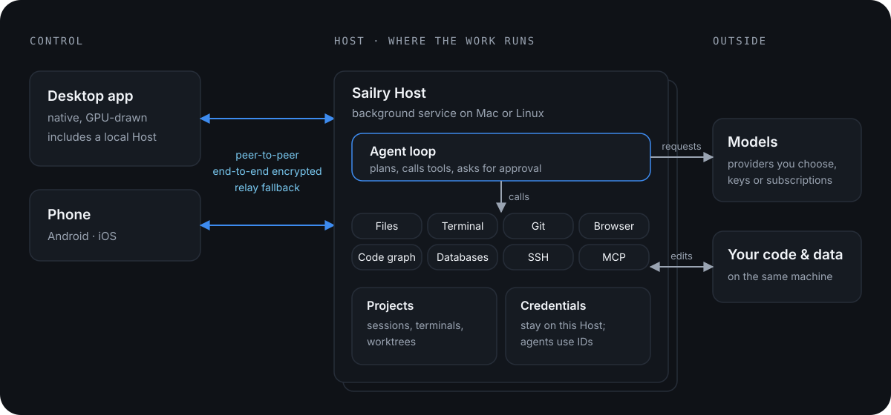

本目录派生自 sailry-harness，见 NOTICE。

<p align="center">
  
</p>

<p align="center">
  <a href="LICENSE"></a>
  <a href="#install"></a>
  <a href="#install"></a>
  <a href="#install"></a>
  <a href="https://github.com/ai-poet/agent-client/desktop/stargazers"></a>
  <a href="https://discord.gg/MCDktmDey"></a>
</p>

<p align="center">
  <a href="README.zh-CN.md">简体中文</a> ·
  <a href="docs/hosts.md">Hosts</a> ·
  <a href="docs/models.md">Models</a> ·
  <a href="docs/projects.md">Projects</a> ·
  <a href="sdk/plugins.md">Plugin SDK</a>
</p>

Sailry is an open-source AI harness: agent teams that run on your own Mac or Linux machines, next
to your code and data, driven from the desktop app or your phone on the
[models you choose](docs/models.md).

> [!NOTE]
> **Early preview.** Sailry changes quickly between releases. Back up important work before
> agents edit it, and [report issues](https://github.com/ai-poet/agent-client/desktop/issues) — your
> feedback shapes what comes next.

<p align="center">
  
</p>

## How it works

<p align="center">
  
</p>

- **Any computer becomes a Host.** Install Sailry Host on a laptop, a Linux box in the lab or a
  rented GPU machine. It runs as a background service, so work keeps going when you close the
  laptop.
- **Reach it from anywhere.** No port forwarding, VPN or cloud account.

## Features

### An agent beyond code

- **Code** — three work modes (Standard; Plan, which plans without running code or writing
  files; Collaborate, which runs an agent team), multi-file edits, Git and worktrees, terminals
  and code review.
- **Browse and operate** — a built-in browser the agent reads, clicks and screenshots; pick page
  elements straight into the conversation; desktop computer use.
- **Content and research** — interactive HTML previews, images and video, web search
  and text knowledge collections.
- **Keep going** — long-term memory, searchable history, goals that run until they are done,
  reminders and scheduled tasks.
- **Connectors** — GitHub, Notion, Slack, Linear, Figma, Google Workspace, Microsoft 365, Feishu,
  DingTalk, WeCom and [more](https://github.com/sailry/sailry-plugins).

### Agent teams, one model per seat

Collaborate mode fans work out to parallel subagents, each on its own model — DeepSeek writes the
code, Claude plans, Codex takes the hard problems — and every step stays visible in the
conversation, where you approve actions as they run.

### Built-in coding tools

Coding plugins work the moment you open a project — no language servers, drivers or extensions to
install. Structured tools return the result the agent needs instead of raw shell output.

- **Code graph** — symbol search, file outlines, callers and callees, change impact and a ranked
  project map, so agents read the right code instead of searching the whole tree.

This desktop variant omits SSH, external database connections, Office/PDF extraction
and local inference, including dictation. It retains iroh networking, WSL setup,
online models, text knowledge collections, files, Git and local terminals.

### Your phone is the remote control

Pair the Android or iOS app with your desktop or any Host using a six-digit code. Pick up any
session, send and queue messages, answer approvals and follow tools as they run. No account and
no subscription.

### Native, light and fast

Written in Go and drawn on the GPU with [MyGo](https://github.com/egoist/mygo)'s native UI
toolkit — no Electron and no bundled browser engine.
It starts fast, stays responsive in long conversations and leaves your memory to your work.

### Plugins and themes

- **Open standards** — [agent-plugins](https://agent-plugins.org) packages, standard `SKILL.md`
  skills and direct MCP servers.
- **Native plugin UI** — pages, panels and settings written in JavaScript render with the same
  components as the rest of the app.
- **Themes** — colors, typography, surfaces and decorations come from one set of tokens, in light
  and dark. Official themes live in [sailry-themes](https://github.com/sailry/sailry-themes).
- Browse the official [plugins](https://github.com/sailry/sailry-plugins) or build your own with
  the Apache-2.0 [SDK](sdk/plugins.md).

## Privacy

Sailry sends anonymous error reports (app version, device type and error codes) and anonymous
feature counts by default. They never include conversations, files, credentials, paths or custom
names. Turn either off in **Settings › Diagnostics and privacy**, or set `SAILRY_TELEMETRY=off` or
`DO_NOT_TRACK=1` for the desktop app or a Host.

Sailry downloads public model scores from [ModelDial](third_party_licenses/modeldial.md)
and model metadata from models.dev without sending user data.

## Install

[Changelog](CHANGELOG.md) · [Build from source](CONTRIBUTING.md#setup)

| | Download | Requires |
| --- | --- | --- |
| **Desktop** | macOS: [Apple silicon](https://github.com/ai-poet/agent-client/desktop/releases/latest/download/Sailry-aarch64-apple-darwin.dmg) · [Intel](https://github.com/ai-poet/agent-client/desktop/releases/latest/download/Sailry-x86_64-apple-darwin.dmg)<br>Windows: [x64](https://github.com/ai-poet/agent-client/desktop/releases/latest/download/Sailry-x86_64-pc-windows-msvc-setup.exe) | macOS 13+ · Windows 10+ (x64) · Linux planned |
| **Host** | macOS: [Apple silicon](https://github.com/ai-poet/agent-client/desktop/releases/latest/download/sailry-host-aarch64-apple-darwin.tar.gz) · [Intel](https://github.com/ai-poet/agent-client/desktop/releases/latest/download/sailry-host-x86_64-apple-darwin.tar.gz)<br>Linux: [x64](https://github.com/ai-poet/agent-client/desktop/releases/latest/download/sailry-host-x86_64-unknown-linux-gnu.tar.gz) · [ARM64](https://github.com/ai-poet/agent-client/desktop/releases/latest/download/sailry-host-aarch64-unknown-linux-gnu.tar.gz) | macOS 13+ · Linux with glibc 2.34+ · Windows planned |
| **Mobile** | [Android APK](https://github.com/ai-poet/agent-client/desktop/releases/latest/download/Sailry-android-arm64.apk) · [iOS TestFlight](https://testflight.apple.com/join/qaTnVrmQ) (beta) | Android 7.0+ · iOS 15+ |

Or install a Host from the terminal:

```sh
curl -fsSL https://github.com/ai-poet/agent-client/desktop/releases/latest/download/install-host.sh | bash
```

## Get started

1. [Add a model provider](docs/models.md#add-a-provider) in **Settings → Models** with an
   API key or a ChatGPT or Claude account.
2. Add a folder or clone a repository as a project on **Local device** or a connected Host.
3. Choose **Create session**, pick a model and describe your task.
4. [Add a Host and pair your devices](docs/hosts.md#install-and-pair) to work from anywhere.

Guides: [Models](docs/models.md) · [Remote hosts](docs/hosts.md) · [Projects and sessions](docs/projects.md)

## 登录与模型网关

CheapRouter 账号登录是可选的，用来快速接入模型网关。未登录、没有网络或网关同步失败时，应用照常进入主界面，本地项目、会话、终端和其他模型 provider 不受影响。登录入口在 **设置 → CheapRouter 账号**；已有功能和其他模型 provider 配置不会被删除或改写。

- 可选择主站 `https://cheaprouter.cc` 或 CDN `https://cdn.cheaprouter.cc`，两者连接同一账号和网关。
- 浏览器登录使用 PKCE S256 和 `127.0.0.1` 临时端口回跳。浏览器不会把 URL fragment 发给本地服务，因此回跳页会通过本地 POST 将一次性登录码交给应用。无法使用 loopback 时，可直接粘贴登录码或完整回跳链接。
- OAuth 凭据保存在 profile 下的 `cheaprouter-account.json`，文件权限为 0600。访问令牌会在到期前 120 秒刷新；令牌和 PKCE verifier 不写入日志，也不会出现在错误提示中。
- 登录后，应用读取 `auth/me`、模型目录和 `keys`，将网关 `base_url` 与所选 API key 写入 sailry 现有的 OpenAI 兼容 provider。模型对话仍走既有的重试、流式响应和凭据保护链路，没有新增协议 wire 类型。
- 登录成功会显示账号、套餐、余额和可用模型数。退出登录会撤销本地会话并禁用 CheapRouter provider，不影响其他 provider。登录状态被服务端拒绝（续期失败或令牌失效）时同样清除本地凭据并禁用 CheapRouter provider，账号页回到未登录并说明原因。

可用标准库 `httptest` 假服务验证完整鉴权与模型请求，无需真实账号：

```sh
GOTOOLCHAIN=go1.27.3 CGO_ENABLED=0 go test ./internal/cheapauth/... ./internal/node/providers/... ./internal/node/agent/model/...
```

## 旧客户端数据迁移

首次启动会只读检测 `~/.cheaprouter`（可用 `SUB2API_DATA_DIR_NAME` 覆盖）中的旧版 CheapRouter 数据；旧 Release 的 daemon 数据库也会从对应平台的 `CheapRouter` 应用支持目录检测。检测到项目或会话时，迁移向导先展示数量，确认后才导入；失败不会阻止新客户端启动，可在向导或 **Settings → General** 重试。

- 迁移前将使用到的源文件原样备份到 profile 的 `migration-backup-<UTC 时间戳>/`，旧目录不会删除或改写。
- **备份是原样副本**：旧目录里若有凭据文件，备份中会带着它的明文副本（这是「原样复制」的必然结果，不是迁移写入了 token）。确认迁移无误后可删除该目录。
- 项目、会话和消息按稳定 ID 导入；`migration.json` 防止重复迁移，“重新迁移”只补缺，不覆盖新客户端已有内容。
- `migration-report.json` 列出无法无损映射的字段。凭据仅保留账号标识和端点，不迁移 token 或 API key，需在新客户端重新登录。

## 前置条件与已知限制

- 构建与测试一律 `GOTOOLCHAIN=go1.27.3 CGO_ENABLED=0`。
- 涉及本地存储的包（如 `internal/desktop/live`、`internal/node/store` 的部分测试）需要 Turso native 库：先 `sh native/turso/build.sh` 生成 `.runtime/native/<os>-<arch>/libturso_sync_sdk_kit.so`，再用 `SAILRY_TURSO_LIB=<路径>` 跑测试。该脚本要求 **rustup**（`native/turso/rust-toolchain.toml` 钉死 toolchain `1.98.0`），用系统 rustc（如 1.85.x）会因依赖要求更高版本而编译失败；没有 rustup 的机器需要预编译产物。
- 无网络/无图形环境（CI 容器）下 `internal/desktop/live` 的部分用例会失败，属环境限制。
- **无 GPU 的机器**（没有 `/dev/dri`）也能跑：MyGo 自动降级到 CPU 渲染，日志会打印 `native UI draws with no GPU`，界面正常但更耗 CPU。
- **原生 iroh 库**：启动缺少 `libsailry_iroh.so` 时会直接报 `Sailry could not start: native iroh library is unavailable`。除了 `sh native/iroh/build.sh` 现编，也可以把预编译产物放到 `native/iroh` 下并用 `SAILRY_IROH_LIB=<路径>` 指定；CI/分发包必须随包提供它，不能指望首次启动现编。

## Client updates

Application updates are disabled by default. An optional `update.json` in the
Desktop profile accepts `feed_url` (the full MyGo platform-manifest URL),
`public_key` (a base64 Ed25519 key), `enabled`, `automatic` and `prereleases`.
The file must contain both source fields before `enabled` can take effect. Once
the settings page writes it, its permissions are 0600.

**Settings → About** shows the running version, manual checks, download progress
and readable failures. Automatic mode performs one quiet check shortly after
launch. MyGo verifies the signed package before installation; the running build
must also have MyGo updater support and its matching build-time public key.
Development builds and package-manager installations can decline self-update.
This client feature does not generate manifests, sign releases or upload files.

## Community

Join the [Discord](https://discord.gg/MCDktmDey) or add the maintainer on WeChat for the group
chat. Please use [GitHub Issues](https://github.com/ai-poet/agent-client/desktop/issues) for bug reports
and feature requests, and [SECURITY.md](SECURITY.md) to report vulnerabilities privately.
Want to contribute? Start with [CONTRIBUTING.md](CONTRIBUTING.md).

<p align="center">
  
</p>

## License

Sailry is licensed under [Apache-2.0](LICENSE), as are the plugin SDK in [sdk/](sdk/) and the
official [plugins](https://github.com/sailry/sailry-plugins) and
[themes](https://github.com/sailry/sailry-themes). The license does not cover the Sailry name or
logos; see [TRADEMARKS.md](TRADEMARKS.md). Third-party materials keep their own licenses; see
[NOTICE](NOTICE) and [third-party notices](third_party_licenses/).

[](https://github.com/ai-poet/agent-client/desktop/graphs/contributors)
